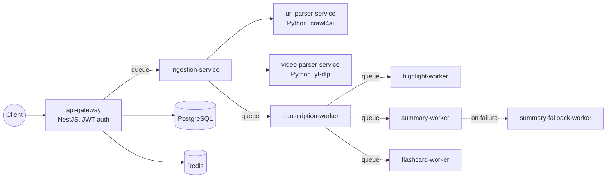

<div align="center">

# Lectrum

**English** · [Русский](README.ru.md)

Turns a lecture recording, a document or a link into a transcript, highlights, a summary, flashcards and a quiz, and lets you ask questions about it.

[](https://github.com/WhymeUMR/Lectrum/actions/workflows/test.yml)
[](https://github.com/WhymeUMR/Lectrum/actions/workflows/e2e.yml)


</div>

## What it does

You give it a source:

- an audio or video file;
- a document: PDF, PPTX, DOCX or plain text;
- a link to a web page or to a video.

Lectrum pulls the text out of it and then, on request, builds:

- a transcript with timed segments;
- highlights: the key moments of the lecture;
- a short summary;
- flashcards, and a quiz with answer checking and stats;
- an assistant that answers questions using only the lecture material;
- a spoken retelling (TTS), including a karaoke mode where the text is highlighted as it is read.

## Architecture

Each step runs in its own service. Services talk through BullMQ queues on Redis, so a slow step (transcription, LLM calls) never blocks the API, and a failed job can be retried on its own.



| Service | What it does |
|---|---|
| `api-gateway` | HTTP API, auth (login/password, Google, Telegram), jobs, quizzes, assistant and TTS; Swagger at `/docs` |
| `ingestion-service` | accepts the source and prepares it for processing |
| `url-parser-service`, `video-parser-service` | extract text from a web page and a video link |
| `transcription-worker` | speech-to-text (OpenAI Whisper or Deepgram) and text extraction from documents |
| `highlight-worker`, `summary-worker`, `flashcard-worker` | LLM generation of each artifact |
| `summary-fallback-worker` | a second summary path for when the main one fails |
| `packages/contracts`, `config`, `pipeline` | shared types, config validation and job statuses |

A job moves through `QUEUED → INGESTING → TRANSCRIBING → … → COMPLETED` (or `FAILED` with an `errorCode`). The client polls `GET /api/v1/jobs/:id/result`; the response tells it how often to poll.

## Quick start

You need Docker with Compose and Node.js 20+.

```bash
git clone https://github.com/WhymeUMR/Lectrum.git && cd Lectrum
make up        # builds and starts all services
make health    # checks every service
```

| Address | What's there |
|---|---|
| http://localhost | web client |
| http://localhost:3100/docs | Swagger UI |
| http://localhost:3100/api/v1 | API |

Without any keys everything starts, and transcription runs on a mock provider. To get real results, put your keys in `.env` (it is git-ignored and overrides `env/.env.local`):

```bash
OPENAI_API_KEY=...          # any OpenAI-compatible API, e.g. OpenRouter via OPENAI_BASE_URL
DEEPGRAM_API_KEY=...        # optional, for transcription
ELEVENLABS_API_KEY=...      # optional, for TTS
TRANSCRIPTION_PROVIDER=openai   # mock | openai | deepgram
```

All available settings are listed in [`.env.example`](.env.example).

## Tests

```bash
make lint
make test              # per-package tests
npm run test:unit      # cross-service unit tests
npm run test:gateway   # api-gateway tests
make test-e2e          # starts the whole stack in Docker and runs a lecture through it
```

The e2e test registers a user, uploads a file, checks that a second concurrent upload gets `409`, waits for the transcript and requests flashcards.

## More

Full API reference, environment variables and troubleshooting: [docs/project-documentation.md](docs/project-documentation.md).
