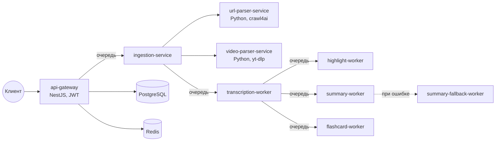

<div align="center">

# Lectrum

[English](README.md) · **Русский**

Превращает запись лекции, документ или ссылку в транскрипт, ключевые моменты, конспект, флешкарты и тест, а ещё отвечает на вопросы по материалу.

[](https://github.com/WhymeUMR/Lectrum/actions/workflows/test.yml)
[](https://github.com/WhymeUMR/Lectrum/actions/workflows/e2e.yml)


</div>

## Что умеет

На вход подойдёт:

- аудио- или видеофайл;
- документ: PDF, PPTX, DOCX или обычный текст;
- ссылка на веб-страницу или на видео.

Lectrum достаёт из источника текст и дальше по запросу собирает:

- транскрипт с разбивкой по времени;
- ключевые моменты лекции;
- короткий конспект;
- флешкарты и тест с проверкой ответов и статистикой;
- ассистента, который отвечает только по материалу лекции;
- озвученный пересказ (TTS), в том числе в режиме караоке с подсветкой текста.

## Как устроено

Каждый шаг работает в отдельном сервисе, сервисы общаются через очереди BullMQ на Redis. Медленные шаги вроде транскрипции и запросов к LLM не тормозят API, а упавшую задачу можно перезапустить отдельно.



| Сервис | Что делает |
|---|---|
| `api-gateway` | HTTP API, авторизация (логин и пароль, Google, Telegram), задачи, тесты, ассистент и TTS; Swagger на `/docs` |
| `ingestion-service` | принимает источник и готовит его к обработке |
| `url-parser-service`, `video-parser-service` | достают текст из веб-страницы и из видео по ссылке |
| `transcription-worker` | распознавание речи (OpenAI Whisper или Deepgram) и извлечение текста из документов |
| `highlight-worker`, `summary-worker`, `flashcard-worker` | генерация через LLM |
| `summary-fallback-worker` | запасной путь для конспекта, если основной упал |
| `packages/contracts`, `config`, `pipeline` | общие типы, проверка конфигурации и статусы задач |

Задача проходит статусы `QUEUED → INGESTING → TRANSCRIBING → … → COMPLETED` или `FAILED` с `errorCode`. Клиент опрашивает `GET /api/v1/jobs/:id/result`, и ответ сам подсказывает, как часто это делать.

## Быстрый старт

Нужны Docker с Compose и Node.js 20+.

```bash
git clone https://github.com/WhymeUMR/Lectrum.git && cd Lectrum
make up        # собирает и запускает все сервисы
make health    # проверяет каждый сервис
```

| Адрес | Что там |
|---|---|
| http://localhost | веб-клиент |
| http://localhost:3100/docs | Swagger UI |
| http://localhost:3100/api/v1 | API |

Без ключей всё запускается, а транскрипция работает на заглушке. Для настоящих результатов положи ключи в `.env`: он в `.gitignore` и перекрывает `env/.env.local`.

```bash
OPENAI_API_KEY=...          # любой OpenAI-совместимый API, например OpenRouter через OPENAI_BASE_URL
DEEPGRAM_API_KEY=...        # необязательно, для транскрипции
ELEVENLABS_API_KEY=...      # необязательно, для озвучки
TRANSCRIPTION_PROVIDER=openai   # mock | openai | deepgram
```

Все настройки перечислены в [`.env.example`](.env.example).

## Тесты

```bash
make lint
make test              # тесты пакетов
npm run test:unit      # сквозные unit-тесты
npm run test:gateway   # тесты api-gateway
make test-e2e          # поднимает весь стек в Docker и прогоняет через него лекцию
```

e2e регистрирует пользователя, загружает файл, проверяет, что вторая одновременная загрузка получает `409`, ждёт транскрипт и запрашивает флешкарты.

## Подробнее

Полное описание API, переменных окружения и частых проблем: [docs/project-documentation.md](docs/project-documentation.md).
